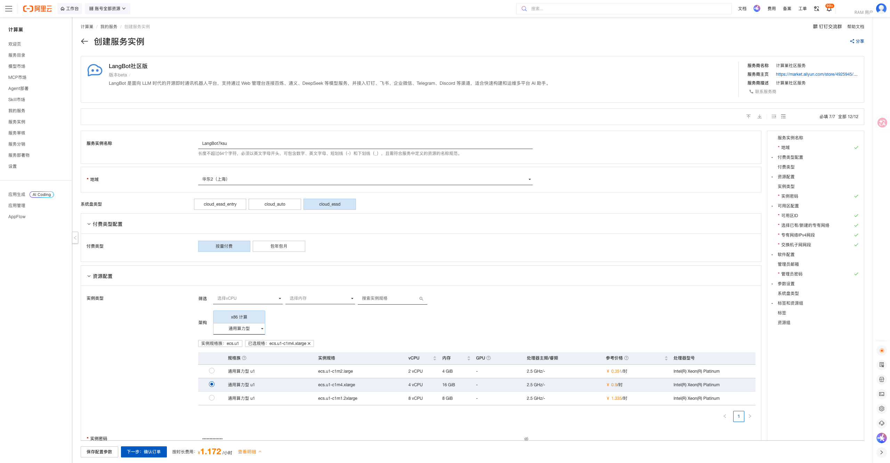
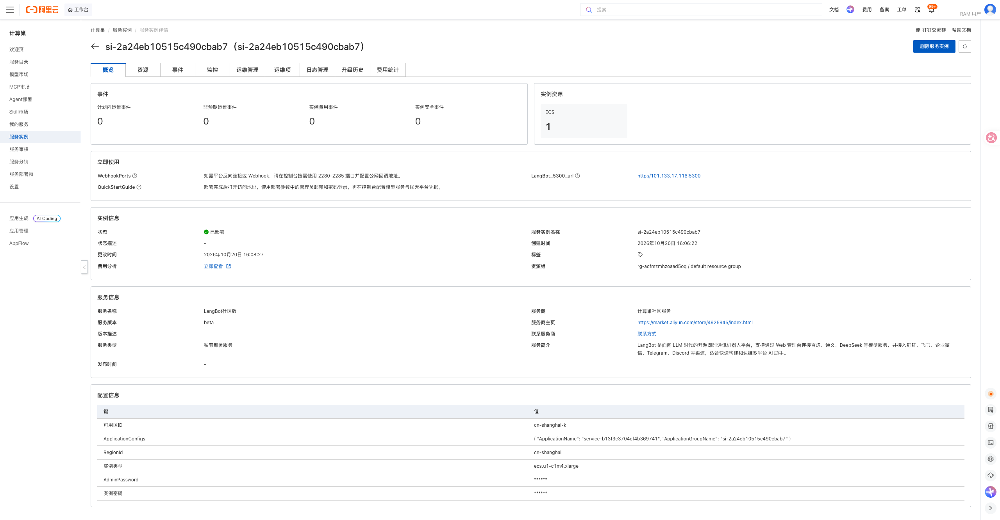
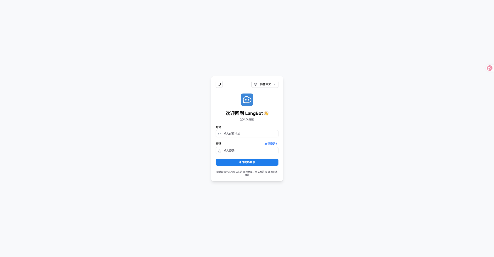

# LangBot 计算巢部署文档

## 概述

[LangBot](https://github.com/RockChinQ/LangBot) 是面向 LLM 时代的开源即时通讯机器人平台，支持通过 Web 管理台连接百炼、通义、DeepSeek 等模型服务，并接入钉钉、飞书、企业微信、Telegram、Discord 等渠道，适合快速构建和运维多平台 AI 助手。本方案将其部署在用户自己的 ECS 中。

| 项目 | 说明 |
| --- | --- |
| 服务 ID | `service-b13f3c3704cf4b369741` |
| 部署形态 | 单台 ECS + Docker Compose |
| 访问方式 | 公网访问管理台 |
| 应用端口 | 5300（Web 管理台） |
| Webhook 端口 | 2280-2285（平台反向连接按需放行） |
| 实测部署耗时 | 约 3 分钟 |

## 部署步骤

### 1. 打开创建页面

访问 [LangBot 服务实例创建页](https://computenest.console.aliyun.com/service/instance/create/cn-hangzhou?type=user&ServiceId=service-b13f3c3704cf4b369741)。

### 2. 配置部署参数

| 参数 | 说明 | 建议 |
| --- | --- | --- |
| 服务实例名称 | 控制台中用于识别本次部署 | 保持默认或自定义 |
| 地域、可用区 | ECS 所在位置 | 选择接近使用者且有库存的地域和可用区 |
| 付费类型 | 按量付费或包年包月 | 测试使用按量付费 |
| 实例类型 | ECS 规格 | 提供 3 种通用算力型 u1 规格 |
| 管理员密码 | Web 管理台登录密码 | 使用符合页面规则的强密码 |
| 管理员邮箱 | 管理台登录邮箱（选填） | 可留空，部署后可在界面查看/修改 |
| 实例密码 | ECS 登录密码 | 使用符合页面规则的强密码 |
| 专有网络 | 新建或复用 VPC | 首次部署可选择新建 |
| VPC/交换机网段 | 网络地址范围 | 无冲突时保持默认 |
| 系统盘类型 | ECS 系统盘 | 默认 `cloud_essd` |

管理员密码在部署时设置，请勿使用弱密码，也不要将密码写入文档或代码仓库。

填写完成并看到询价结果后，点击“下一步：确认订单”，核对资源和费用，勾选服务协议并创建实例。

### 3. 等待部署完成

进入服务实例详情页，等待状态变为“已部署”。本次实测从创建到部署完成约 3 分钟。

### 4. 进入应用

在实例详情页「立即使用」区域打开访问地址。

打开访问地址，使用部署参数中的管理员邮箱和密码登录，再在管理台配置模型服务与聊天平台凭据；如需平台反向连接或 Webhook，在安全组按需放行 2280-2285 端口并配置公网回调地址。

## 数据与安全

- 管理台公网可访问，使用部署时设置的管理员密码认证；生产环境建议在安全组中限制来源 IP 并配置 HTTPS 反向代理。
- 模型服务凭据与平台凭据保存在你自己的实例中；各平台接入需遵守对应平台的开放规则。
- 会话与配置数据均在实例本地；删除实例前请备份需要保留的内容。

## 资源释放

不再使用时，在计算巢服务实例详情页执行“删除”。删除完成后建议继续确认：

1. 服务实例已不存在；
2. ROS 资源栈状态为 `DELETE_COMPLETE`；
3. ECS、VPC、交换机和安全组均无残留；
4. 账单中不再产生相关按量资源费用。

删除服务实例会同时删除 ECS 及其本地数据，请提前导出或备份重要文件和配置。

## 官方链接

- [LangBot 官方仓库](https://github.com/RockChinQ/LangBot)
- [LangBot 官方文档](https://langbot.rockchin.top/)

- [阿里云计算巢文档](https://help.aliyun.com/zh/compute-nest/)
